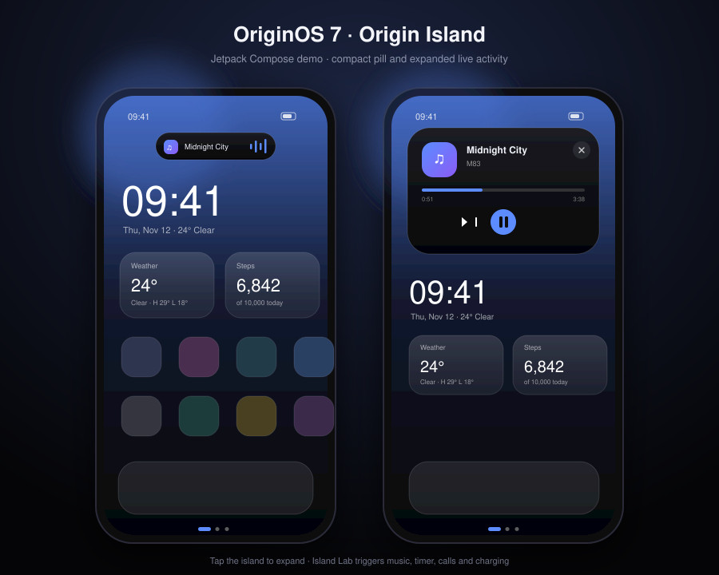

# OriginOS 7 Demo — Origin Island

An Android demo app that recreates the feel of **OriginOS 7 by vivo**, focused on the
signature **Origin Island**: the black capsule at the top of the screen that morphs into
a live-activity card.

Everything is rendered in-app with Jetpack Compose. No root, no overlay permission, no
notification access, and no vivo hardware required — it runs on any Android 8.0+ device.



## What it does

| Feature | Details |
| --- | --- |
| **Idle island** | A small black pill with a camera lens, just like the OriginOS status area. |
| **Music** | Album art, title, animated equalizer, progress, play/pause, previous/next. |
| **Timer** | Countdown ring, running/paused state, pause, resume and reset. |
| **Call** | Compact incoming-call pill with accept/decline, plus a connected state with a live call timer. |
| **Message** | Incoming chat pill with sender and snippet; expands to a card with Reply / Later actions and a "Reply sent" state. Unread count feeds the lock-screen badge. |
| **Charging** | 44W FlashCharge style card with battery percentage and fill animation. |
| **Morph animation** | Spring-based width/height/corner animation between pill and card. |
| **Home screen stage** | Mock OriginOS home screen: wallpaper glow, clock, weather/steps widgets, app grid, dock. |
| **Lock screen** | Big clock, date, weather, notification cards, swipe-up-to-unlock. |
| **Control center** | Swipe down from the status bar: quick toggles, brightness/volume sliders, media card. |
| **Island Lab** | Bottom sheet to trigger each activity or message, dismiss or lock, and switch accent colors. |

## Screens and gestures

- **Lock screen** — shown on launch. Swipe up or tap the hint to unlock; the Island Lab's
  **Lock screen** action returns to it. The message badge reflects the unread count and
  clears when you reply from the island.
- **Home** — live clock, date, weather and step widgets, 12-app grid, glass dock, page dots.
- **Island** — expands automatically after an activity is triggered, or tap the pill to toggle.
  Swipe down on it to dismiss the activity and return to the idle pill.
- **Control Center** — swipe down along the status bar, or tap the small chevron in the
  top-left corner. Swipe up on the panel (or tap the scrim / close button) to dismiss.
- **Island Lab** — tap the floating **Island Lab** button above the dock.

All toggles, sliders, notifications and charging values are local demo state; nothing
touches real system settings.

## Build the APK

### Option 1 — GitHub Actions (no local SDK needed)

1. Create a new GitHub repository and push this project.
2. Open the **Actions** tab. The **Build APK** workflow runs on every push to `main`
   and can also be started manually with **Run workflow**.
3. Download the `originos7-demo-debug` artifact and install the APK.

### Option 2 — Android Studio

1. Open the project folder in Android Studio (Ladybug or newer).
2. Let Gradle sync, then press **Run**.

### Option 3 — Command line

```bash
# JDK 17 and the Android SDK are required
export ANDROID_HOME=$HOME/Android/Sdk
./gradlew assembleDebug
adb install -r app/build/outputs/apk/debug/app-debug.apk
```

> The checked-in Gradle wrapper uses Gradle 8.9 and Android Gradle Plugin 8.7.3,
> with Kotlin 2.0.21 and Compose BOM 2024.10.01.

## Project structure

```
app/src/main/java/com/example/originos/
├── MainActivity.kt              # edge-to-edge Compose host
├── IslandViewModel.kt           # island state + simulated media/timer/call ticks
├── island/
│   ├── IslandContent.kt         # Idle / Music / Timer / Call / Charging models
│   └── OriginIsland.kt          # the morphing island UI
├── home/
│   ├── Clock.kt                 # shared once-per-second clock
│   └── HomeScreen.kt            # mock OriginOS home screen
└── ui/
    ├── DemoRoot.kt              # wallpaper + island overlay + lab button
    ├── ControlCenter.kt         # swipe-down panel, toggles, sliders, media card
    ├── LockScreen.kt            # lock screen with swipe-up-to-unlock
    ├── IslandLabSheet.kt        # activity triggers, lock action and accent picker
    └── theme/Theme.kt           # dark Material 3 theme
```

## Notes

- This is a **demo**, not a launcher or a system mod. It cannot replace the real
  OriginOS island, which is integrated into vivo's system UI.
- All media, calls, timers and charging data are simulated locally.
- Minimum Android version: **8.0 (API 26)**; target SDK 35.

## Ideas for next iterations

- Real `MediaSession` integration for actual now-playing data.
- `NotificationListenerService` to mirror real notifications in the island.
- Swipe-to-dismiss and drag gestures on the island.
- Weather-driven wallpaper gradients and matching always-on display.
- Light theme and additional vivo-style widgets.
